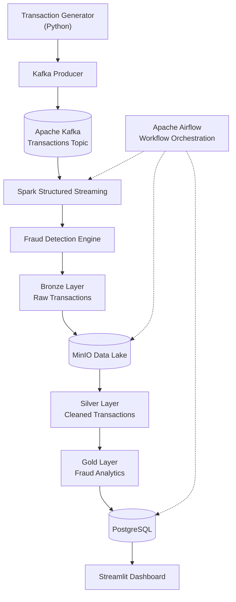

# Real-Time Fraud Detection Pipeline

## Overview

A real-time data engineering pipeline designed to process financial transactions and detect potentially fraudulent activities using distributed streaming technologies.

The system uses Apache Kafka for event ingestion and Apache Spark Structured Streaming for real-time data processing. Transaction events are evaluated using rule-based fraud detection logic and organized using the Medallion Architecture for downstream analytics.

## Architecture

The following diagram illustrates the proposed end-to-end data pipeline.




### Architecture Components

| Component | Responsibility |
|---|---|
| Transaction Generator | Generates simulated financial transactions. |
| Kafka Producer | Publishes transaction events to Kafka. |
| Apache Kafka | Provides distributed event streaming and message retention. |
| Spark Structured Streaming | Processes incoming transaction streams. |
| Fraud Detection Engine | Evaluates transactions against predefined fraud rules. |
| MinIO | Provides S3-compatible object storage. |
| Medallion Architecture | Organizes raw, cleaned, and aggregated transaction data. |
| PostgreSQL | Stores processed data and analytics. |
| Apache Airflow | Orchestrates data workflows. |
| Streamlit | Provides transaction analytics and fraud monitoring. |

## Technology Stack

| Category | Technology |
|---|---|
| Programming Language | Python |
| Data Generation | Python Faker |
| Event Streaming | Apache Kafka |
| Stream Processing | Apache Spark Structured Streaming |
| Object Storage | MinIO |
| File Format | Apache Parquet |
| Database | PostgreSQL |
| Workflow Orchestration | Apache Airflow |
| Dashboard | Streamlit |
| Containerization | Docker |
| Infrastructure | Docker Compose |

## Key Features

### 1. Real-Time Transaction Processing

- Continuous transaction ingestion through Kafka.
- Distributed stream processing using Spark Structured Streaming.
- Event-driven data processing architecture.

### 2. Fraud Detection Rules

The pipeline is designed to identify suspicious transactions using the following rules:

- **High Transaction Amount:** Detect transactions exceeding a predefined amount threshold.
- **Transaction Velocity:** Identify multiple transactions within a short time window.
- **Geolocation Anomalies:** Detect transactions originating from geographically distant locations within an unusually short period.
- **Suspicious Merchant Categories:** Flag transactions associated with predefined high-risk merchant categories.
- **Suspicious IP Detection:** Identify transactions originating from suspicious IP addresses.

### 3. Medallion Architecture

The pipeline follows a three-layer data architecture.

| Layer | Description |
|---|---|
| Bronze | Stores raw transaction events received from Kafka. |
| Silver | Stores cleaned, validated, and transformed transaction records. |
| Gold | Stores aggregated fraud analytics and business metrics. |

Data is stored in Parquet format using MinIO as the object storage layer.

### 4. Reliability and Fault Tolerance

Planned reliability mechanisms include:

- Producer acknowledgements.
- Message retries.
- Consumer offset management.
- Checkpointing.
- Schema validation.
- Dead Letter Queue.
- Idempotent processing.
- Kafka replication.
- Message replay and recovery.

## Repository Structure

```text
fraud-detection-pipeline/
│
├── producer/
│   └── Transaction generator and Kafka producer
│
├── spark-streaming/
│   └── Spark streaming jobs and fraud detection logic
│
├── airflow/
│   └── Airflow DAGs and workflow definitions
│
├── dashboard/
│   └── Streamlit dashboard
│
├── docker/
│   └── Infrastructure configurations
│
├── data/
│   ├── bronze/
│   ├── silver/
│   └── gold/
│
├── configs/
│   └── Application configurations
│
├── logs/
│   └── Application logs
│
├── requirements.txt
├── docker-compose.yml
├── .gitignore
└── README.md
```

## Getting Started

### Prerequisites

Ensure the following tools are installed:

- Python
- Apache Kafka
- Apache Spark
- Docker
- Docker Compose
- PostgreSQL

### Clone the Repository

```bash
git clone <repository-url>
cd fraud-detection-pipeline
```

### Install Dependencies

```bash
pip install -r requirements.txt
```

Infrastructure configuration and component-specific execution instructions will be documented as implementation progresses.

## Project Roadmap

| Version | Milestone |
|---|---|
| v1.0 | Transaction generator and Kafka producer |
| v1.1 | Spark consumer and Bronze layer |
| v1.2 | Silver and Gold transformations |
| v1.3 | Fraud detection rules engine |
| v2.0 | Airflow orchestration, dashboard, and Dockerized infrastructure |

## Current Implementation Status

The initial implementation focuses on transaction event generation and Kafka producer-consumer integration.

The remaining components are planned development milestones and will be updated as they are implemented and tested.

## Project Objectives

- Understand distributed event streaming.
- Implement real-time data processing.
- Explore Apache Spark Structured Streaming.
- Design scalable data lake architectures.
- Implement rule-based fraud detection.
- Understand fault tolerance and recovery mechanisms.
- Develop data orchestration and analytics workflows.

## License

This project is intended for educational and portfolio purposes.
